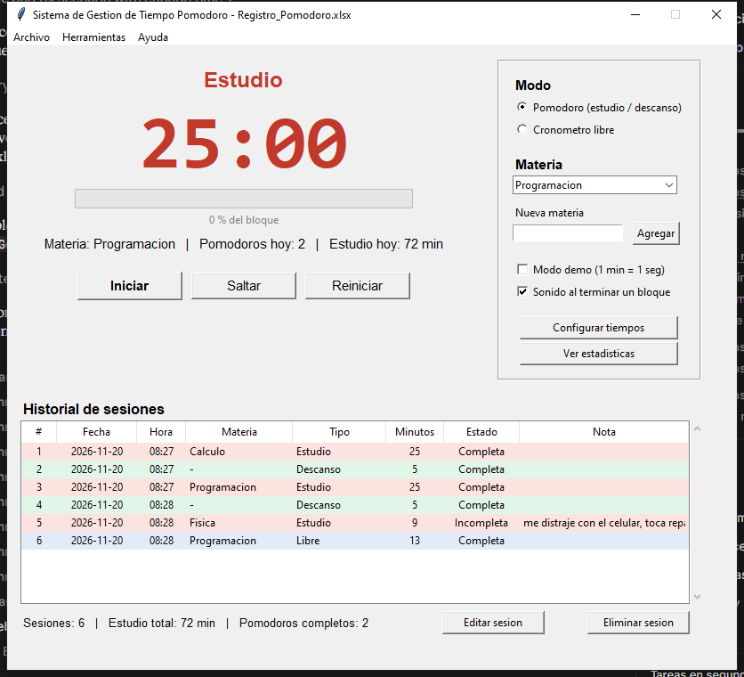

# Sistema de Gestion de Tiempo Pomodoro

Parcial 3 de Programacion II (Python) - Ingenieria Electronica, UTP  
Hector Danilo Alvarez Arenas

Aplicacion de escritorio para estudiar con la tecnica Pomodoro: bloques de 25 minutos de estudio
y 5 de descanso, con un descanso largo cada 4 pomodoros. Cada sesion se guarda en un archivo de
Excel junto con la materia que se estaba estudiando, para despues ver cuanto se estudio de cada una.



## Como ejecutarlo

1. Python 3 con tkinter (viene con Python) y la libreria openpyxl:
   ```
   pip install openpyxl
   ```
2. Ejecutar `main.py`. Si no existe `Registro_Pomodoro.xlsx`, el programa lo crea solo.

La version de consola del parcial 2 se conserva en `MenuPomodoro.py` (se ejecuta ese archivo directamente).

## Clases (una por archivo)

| Clase | Que hace |
|---|---|
| `MedidorTiempo` | Clase padre: duracion, en marcha, formato del tiempo |
| `Temporizador` | Hija 1: cuenta regresiva de los bloques (polimorfismo en `avanzar_segundo()`) |
| `Cronometro` | Hija 2: cuenta hacia arriba para estudio libre |
| `ConfiguracionPomodoro` | Tiempos de estudio y descanso con validacion, modo demo |
| `HistorialSesiones` | Lista de diccionarios con todas las sesiones |
| `SesionPomodoro` | Ciclo Estudio -> Descanso -> Descanso largo |
| `MenuPomodoro` | Menu de consola del parcial 2 |
| `Materia` | Materia con meta diaria de minutos |
| `Estadisticas` | Minutos por materia, pomodoros de hoy, totales |
| `GestorExcel` | **Backend**: crear, leer, escribir, actualizar y eliminar en Excel (openpyxl) |
| `InterfazPomodoro` | **Frontend**: toda la ventana en tkinter |

## Interfaz

Label, Entry, Button, Frame, Combobox (materias), Radiobutton (modo), Checkbutton (modo demo y sonido),
Treeview (historial), Toplevel (configurar tiempos, editar sesion, estadisticas), Menu, messagebox,
filedialog (abrir otro Excel y guardar copia), `.bind()` (atajos de teclado) y try/except.

Elemento extra: **ttk.Progressbar**, muestra cuanto va del bloque actual y el avance de la meta diaria
de cada materia.

### Atajos

- Barra espaciadora: iniciar / pausar
- Enter en "Nueva materia": agregar
- Doble clic en una sesion: editarla
- Suprimir: eliminar la sesion seleccionada
- Escape: cerrar una ventana secundaria

## Excel

`Registro_Pomodoro.xlsx` tiene 3 hojas: **Sesiones**, **Materias** y **Configuracion**.
Los datos quedan guardados al cerrar el programa y se cargan otra vez al abrirlo.
